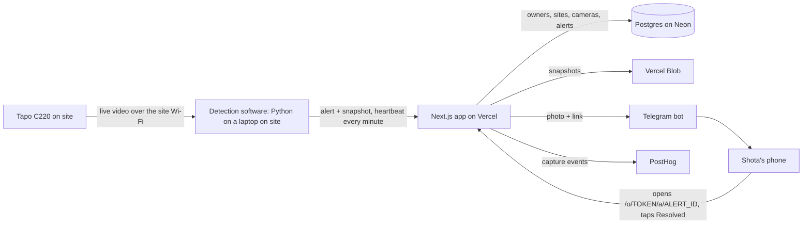

# Architecture

One diagram, one line of why per layer. The question each line answers is not "is this the best technology" but "can this team deploy it at a public URL by the Week 7 lab."

## The diagram

The camera's live video (RTSP) only works on the site's own network, so the detection software runs on a laptop next to the camera. Everything Shota sees is the web app at our public URL, reached through a private link with a long random token; no accounts. Starting values for detection: the software reads the camera's lower-quality stream at 2 frames a second; a worker counts as "no helmet" after 10 seconds in a row (`seconds_confirmed`); a camera has at most one open alert, so further detections don't send a second message.

## The stack, one line per layer

| Layer | Choice | Why we can deploy it by Week 7 (who has done it before, or the free tier that makes it easy) |
|---|---|---|
| Hosting | Vercel | Free tier, HTTPS and a URL in minutes; [who on the team has deployed on it before] |
| App framework | Next.js (App Router) | Server routes mean no separate backend to host; the course setup guide is written for it |
| Database | Postgres on Neon | Hosted, free tier, nothing to run; four tables: owners, sites, cameras, alerts |
| Analytics | PostHog (wired from `setup/SHIP-STACK-SETUP.md`) | fixed for the course |
| Messages out (email, SMS, WhatsApp), if any step needs one | Telegram bot | Free; created in minutes with @BotFather; Shota taps Start once; WhatsApp and SMS need business verification (`Lab-6/setup/messages-out.md`) |
| Sign-in, if any step needs one | None | Shota uses a private tokenized link; the detection software uses a secret device token |
| Camera | Tapo C220 | Bought and streaming: we watched its live video in VLC (`camera-setup.md`); its own person detection does not check helmets |
| Detection software | Python, OpenCV, onnxruntime | Reuses GG's working helmet pipeline (EfficientDet-Lite0 for people, GearGuardNet for helmets) from `feat/helmet-detection-demo` |
| Photo storage | Vercel Blob | Same host, free tier, one call per snapshot |

**Layers we deliberately do not have in Sprint 1:** login, video recording, detection in the cloud (the camera's stream is local only), WhatsApp or SMS, the camera's siren, a mobile app.

## The journey through the stack

| Step | Layer that handles it | Event fired |
|---|---|---|
| 1 | `/o/[token]` shows the site and camera status (from the last heartbeat); "Connect Telegram" opens the bot with Shota's token; `/api/telegram` stores his chat id | `owner_opens_invite_link` (client), `owner_connects_telegram` (server) |
| 2 | The detection software reads the C220's live video, finds a worker without a helmet, and POSTs a snapshot to `/api/alerts`; the route saves it to Blob and inserts an `open` row in `alerts` | `system_detects_violation` (server) |
| 3 | The same route sends the snapshot and link to Shota's Telegram | `system_sends_alert` (server, with `channel` and `delivered`) |
| 4 | `/o/[token]/a/[id]` shows the snapshot, site, time and "No helmet" | `owner_views_alert` (client) |
| 5 | "Resolved" posts to `/api/alerts/[id]/resolve`; the row becomes `resolved` with `resolved_at` | `owner_resolves_alert` (server, after the update returns a row) |

## Secrets and data

- Secrets live in: `app/dashboard/.env.local` and Vercel (`DATABASE_URL`, `BLOB_READ_WRITE_TOKEN`, `TELEGRAM_BOT_TOKEN`, `NEXT_PUBLIC_POSTHOG_KEY`, `POSTHOG_KEY`, `DEVICE_TOKEN`), and `app/detector/.env` (`RTSP_URL` with the camera account password, `API_URL`, `DEVICE_TOKEN`); `.gitignore` lists `.env*`, checked before the first commit of code.
- Personal data we store, and where: snapshots of workers in Vercel Blob at unguessable URLs, deleted after [30] days; Shota's Telegram chat id and his engineer's phone number in `owners`. Never on an event, never in a log line, never in the repo.
- The one thing in this design most likely to break on deploy day: the detection software on site. If the Wi-Fi drops or the laptop sleeps, no alerts arrive and nothing looks wrong. The heartbeat every minute lets the owner page show "Camera offline since HH:MM"; this is the first thing we test.